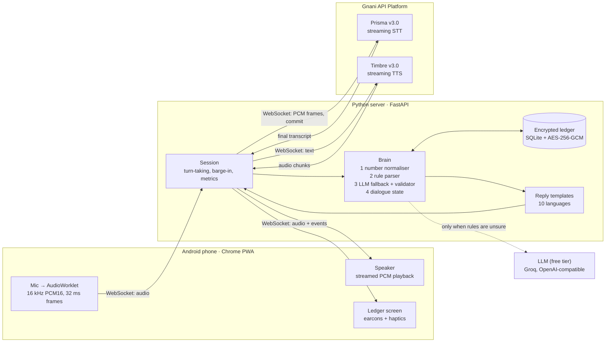

# Munim-ji — a hands-free voice khata for kirana stores

**BolBharat · Gnani Voice AI Innovation Challenge · PS2 (Voice Khata)**

A shopkeeper holds one button and says *"Ramesh ka 340 udhaar, kal 200 diya tha"*.
Munim-ji writes two ledger lines (₹340 credit today, ₹200 payment yesterday), says the new
balance back in one breath, and is ready for the next customer. Mistakes are fixed by voice
(*"nahi, 430"*), questions are answered by voice (*"Ramesh ka total?"*), and the screen never
needs to be touched.

Munim-ji is an AI assistant and says so in its first turn, in the user's language.

---

## What it does

| Requirement in the problem statement | How Munim-ji meets it |
|---|---|
| **Numbers under noise**: "teen sau chaalis", "340", "three-forty" | Streaming Prisma v3.0, then a number normaliser that understands digits, Hindi words (all of 0–99), fractions (*dedh sau*, *dhai hazaar*, *saade teen sau*, *paune do sau*) and English forms. Browser noise suppression plus tuned server VAD. |
| **Ledger logic**: customer, amount, credit or payment, relative dates | Rule parser for Hindi/Hinglish/English; LLM fallback for the other languages. *"ne … diye"* is a payment, *"ko … ka saamaan"* is credit. *kal*, *parso*, *3 din pehle* are resolved to dates. |
| **Spoken corrections**: "nahi, 430" | Fixes amount, name, direction or date of the last entry. After a two-line entry, *"nahi, 430"* fixes the amount it sounds like (340, not 200). *"hata do"* removes the entry. |
| **Two customers share a name** | Asks one short question: *"Kaun se? Doodh wale Ramesh Kumar ya Ramesh Gupta?"* Answer with a descriptor, a surname, or *"pehla / doosra"*. |
| **Spoken answers within 2 s** | Queries are plain SQL and replies come from fixed templates, so no LLM is in the path. |
| **Channel**: low-end Android or browser, push-to-talk or wake phrase | Installable PWA with no framework (about 20 KB of JS). Hold-to-talk, or hands-free with the wake phrase *"Munim ji"*. |

Beyond the brief:

- **The ledger trains the ear.** Customer names from the khata are sent to Prisma as `keyterms`, so name recognition improves as the ledger grows.
- **Tense-aware promises.** *"Ramesh kal 200 de dega"* is future tense, so it is noted as a promise and the balance does not change.
- **Entries are never overwritten.** A correction strikes the old line through and adds a new one, like a paper khata. The Entries tab shows the audit trail.
- **Ten languages.** Replies in Hindi, English, Kannada, Tamil, Telugu, Marathi, Bengali, Gujarati, Punjabi and Malayalam, following the language the user speaks.

## Architecture



### Gnani API Platform services used

| Service | Model | Endpoint | Used for |
|---|---|---|---|
| Speech-to-text, realtime | **Prisma v3.0** | `wss://api.vachana.ai/stt/v3/stream` | Streaming transcription with `keyterms`, language hints, server VAD and `commit` |
| Text-to-speech, realtime | **Timbre v3.0** | `wss://api.vachana.ai/api/v1/tts` | Streaming speech for every reply |

Every connection is a WebSocket. There is no telephony, no phone number and no voice cloning.
Orchestration is custom code in [munim/session.py](munim/session.py); no hosted agent platform is used.

### Why it is fast

Time to first audio is measured on every turn (end of user speech to first reply audio) and
shown under the transcript on screen.

1. **`commit` on button release.** Prisma sends only final transcripts, after its silence timer. Releasing the button sends `commit`, which ends the utterance at once.
2. **No LLM on the common path.** Hindi, Hinglish and English entries, corrections and all queries are parsed by rules in a few milliseconds.
3. **One-sentence replies.** Timbre takes a whole sentence per request, so replies are short templates.
4. **Warm sockets.** STT, TTS and the LLM connection are opened when the session starts. After a barge-in closes the TTS socket, a new one is opened immediately.
5. **Barge-in stops audio on the phone first**, then tells the server, so the agent goes quiet without a network round trip.

## Setup

Requires Python 3.11 or newer.

```bash
git clone https://github.com/sanjaysaini383/Bol_Bharat.git
cd Bol_Bharat
python -m venv .venv
# Windows: .venv\Scripts\activate      macOS/Linux: source .venv/bin/activate
pip install -r requirements.txt
cp .env.example .env        # then fill in the keys below
python -m munim
```

Open <http://localhost:8000>, press **Shuru karein**, allow the microphone, then hold the
button and speak.

### Environment variables

| Variable | Required | What it is |
|---|---|---|
| `GNANI_API_KEY` | **Yes** | Your Gnani API Platform key (Prisma v3.0 + Timbre v3.0). |
| `LLM_API_KEY` | Recommended | Key for any OpenAI-compatible chat API. The default is Groq's free tier: <https://console.groq.com/keys>. Without it, Hindi/Hinglish/English still work through rules; the other eight languages need it. |
| `LLM_BASE_URL` | No | Default `https://api.groq.com/openai/v1`. |
| `LLM_MODEL` | No | Default `openai/gpt-oss-120b` (about 0.7 s on Groq). `qwen/qwen3.8-27b` is faster (about 0.5 s) with `LLM_REASONING_EFFORT=none`. Groq retires models; `GET /models` lists the current ones. |
| `LLM_REASONING_EFFORT` | No | Default `low`. Sent only when set; leave it empty for models that do not take it. |
| `KHATA_ENC_KEY` | No | 32-byte base64 key for encryption at rest. If empty, one is generated into `data/khata.key`. |
| `ACCESS_TOKEN` | No | If set, the app needs `?k=<token>` in the URL. Set this on a public demo link. |
| `SHOP_NAME`, `DEFAULT_LANG`, `GNANI_TTS_VOICE`, … | No | See [.env.example](.env.example) for the full list. |

`.env` is in `.gitignore`. No key is ever committed.

### Using it on a phone

Browsers only allow the microphone on `https://` or `localhost`. Either deploy the app
(below) or tunnel your laptop, for example `cloudflared tunnel --url http://localhost:8000`,
and open the HTTPS link on the phone. Then use **Add to Home screen**.

### Deploy

```bash
docker build -t munim-ji .
docker run -p 8000:8000 -v munim-data:/data \
  -e GNANI_API_KEY=... -e LLM_API_KEY=... -e ACCESS_TOKEN=choose-a-token munim-ji
```

Any host that gives HTTPS and WebSockets works (Render, Railway, Fly.io). Choose an India
region to keep the round trip to Gnani short.

### First-run checklist

The speech clients are written against Gnani's published WebSocket protocol. Before a demo,
confirm them with your own key:

1. Record a short 16 kHz mono WAV of your own voice and run `python scripts/probe_stt.py clip.wav`. You should see the transcript and what the agent understood.
2. Compare number output: `--format transcribe` (digits, the default) against `--format codemix`.
3. In the app, check the *"suna → bola"* time under the transcript on a few turns.
4. Note how many credits one minute of talking uses, so 5,000 credits last through judging.

## What to say

| You say | Munim-ji does |
|---|---|
| "Ramesh ka 340 udhaar, kal 200 diya tha" | Two lines: ₹340 credit today, ₹200 payment yesterday |
| "Sunita ne dedh sau diye" | ₹150 payment |
| "Suresh ko 200 ka saamaan diya" | ₹200 credit |
| "Suresh 150" | Asks: *"Udhaar ya jama?"* |
| "Nahi, 430" / "Nahi, jama tha" / "Nahi, Sunita" | Corrects amount / direction / customer |
| "Hata do" | Removes the last entry |
| "Ramesh ka total?" | Balance for Ramesh |
| "Aaj kitna udhaar gaya?" · "Aaj ka hisaab" | Today's credit · today's credit and payments |
| "Sabse zyada kiska baaki hai?" | Top three dues |
| "Ramesh kal 200 de dega" | Notes a promise; balance unchanged |
| "Sunita reminder ke liye raazi hai" | Records reminder consent |
| "Sunita ko reminder bhejo" | Prepares a polite reminder to share (only with consent) |
| "Mera sara data delete karo" | Asks for confirmation, then wipes everything |

In hands-free mode, start with *"Munim ji"*. For eight seconds after a reply, and whenever
Munim-ji has asked a question, the wake phrase is not needed.

## Responsible AI and compliance

| Rule | Implementation |
|---|---|
| **AI disclosure** | The first turn of every session says *"…main Munim-ji hoon, aapka AI khata sahayak"*. If the user switches language, the first reply in the new language discloses again. The start screen states it as well. Tested in `test_first_turn_discloses_ai_in_users_language`. |
| **Synthetic data only** | Demo customers in [munim/seed.py](munim/seed.py) are invented. Use your own voice for test audio. |
| **Encrypted at rest** | Customer names, descriptors and transcripts are encrypted with AES-256-GCM before they are written to SQLite ([munim/crypto.py](munim/crypto.py)). A test reads the raw database file and checks no name appears in it. |
| **Delete after judging** | Transcripts expire after `TRANSCRIPT_RETENTION_HOURS` (default 72) and are purged hourly. `python scripts/purge.py` or the menu button deletes them at once; `--all` or the voice command deletes the ledger too. |
| **No lending** | Requests for interest, loans, late fees or penalties are refused in the user's language. The ledger has no field for interest. |
| **No pressure language** | Requests to threaten or shame a customer are refused. Reminders use one fixed polite template per language, and the final text is still checked against a pressure-word list ([munim/guardrails.py](munim/guardrails.py)). |
| **Opt-in reminders only** | A reminder is produced only when the customer's consent is recorded, and the shopkeeper sends it himself through the phone's share sheet. Nothing is sent automatically. |
| **LLM limits** | The LLM only extracts structure. It never writes a spoken reply, never sees the customer list, and any amount it returns must appear in the transcript or the result is discarded. |
| **Secrets** | Keys live in `.env`, which is git-ignored. |
| **Voices** | Stock Timbre v3.0 voices only. No cloning. |

## Tests and evaluation

```bash
pip install -r requirements-dev.txt
pytest                         # 145 unit, conversation and protocol tests
python scripts/eval_text.py    # 40 scripted conversations, judged like the live test
```

Current result of the conversation eval (rules only, no LLM): **40 / 40** on exact amount,
credit/payment direction and customer. These run on text, so they measure understanding,
not speech recognition. For audio, build a set with `scripts/probe_stt.py` and
`scripts/mix_noise.py` (mixes shop noise under a clean clip at a chosen SNR).

## Project layout

```
munim/
  textnorm.py    one romaniser for all 10 scripts; spelling-tolerant matching keys
  numbers.py     spoken amounts → integers
  parser.py      rule parser: entries, corrections, queries, guardrail intents
  llm.py         LLM fallback (OpenAI-compatible) and output validation
  dialogue.py    dialogue manager: the only code that changes the ledger
  ledger.py      encrypted SQLite khata with an audit trail
  replies.py     reply templates in 10 languages
  guardrails.py  reminder consent and pressure-language gate
  gnani_stt.py   Prisma v3.0 streaming client
  gnani_tts.py   Timbre v3.0 streaming client
  session.py     real-time loop per browser: audio in, audio out, barge-in
  server.py      FastAPI app, static files, WebSocket endpoint
web/             the PWA (HTML, CSS, vanilla JS, AudioWorklet)
scripts/         eval, STT probe, noise mixer, purge
tests/           pytest suite
```

## Known limits

- Number **words** are understood in Hindi and English. In the other languages Munim-ji relies on Prisma writing digits (`format=transcribe`) or on the LLM fallback.
- Reply templates outside Hindi and English were not reviewed by native speakers.
- One shop per server. There are no user accounts; protect a hosted demo with `ACCESS_TOKEN`.
- New customer names reach the recogniser's `keyterms` at the next session start, not mid-session.
